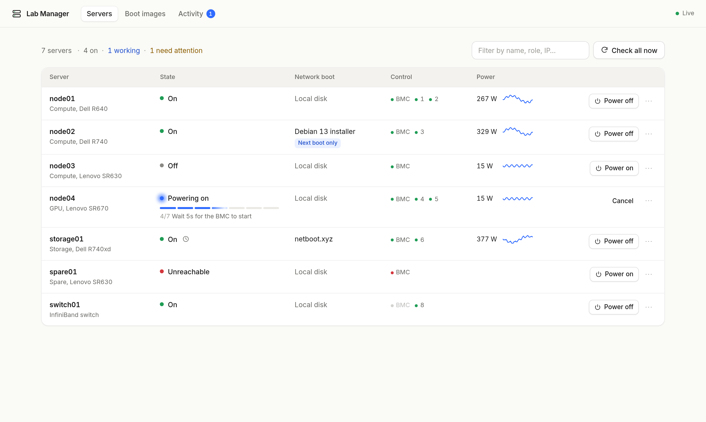
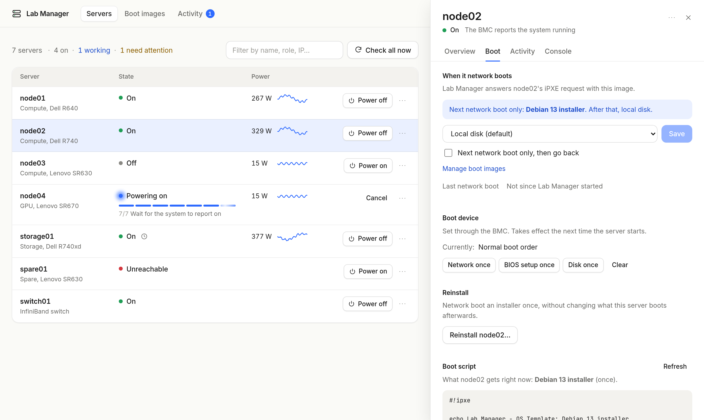
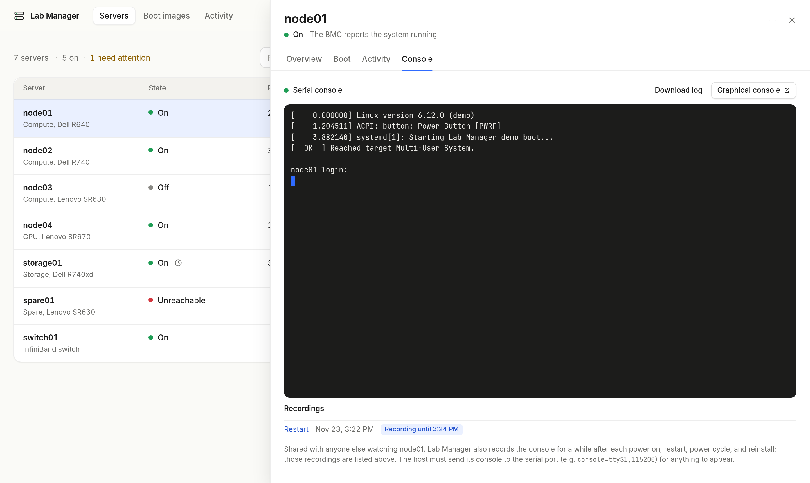

# Lab Manager

[](https://github.com/zgiles/labmgr/actions/workflows/ci.yml)

A web console for the physical servers in a lab. It covers power control through each
server's BMC and PDU outlets, network boot, serial and graphical consoles, and power
monitoring. It's a single Go binary with the web UI built in.



- **Safe power control.** Power on, shut down, restart, and power cycle are planned from
  the server's current state: outlets, then BMC, then power, then confirmation. Each run
  shows its steps live, retries failures, and can be cancelled or scheduled.
- **Network boot.** Keep a library of iPXE boot images, assign them per server or for the
  next boot only, and reinstall a server in one click.
- **Consoles without a BMC login.** A shared serial console in the browser, recorded after
  every reboot, and a one-click graphical console on Dell iDRAC9 and Lenovo XCC.
- **Power and health.** Power draw every 10 seconds with a week of history, plus
  hardware details and the BMC event log.
- **A full record.** Every action is logged with who did it and how each step went.
- **Built for scripts too.** A JSON API with live updates, servers addressed by name, and
  calls that can wait for an operation to finish.

<p>
  
  
</p>

BMCs are reached over Redfish (tested on Dell iDRAC9 and Lenovo XCC). PDUs can be APC over
SNMP or simple HTTP PDUs.

## Try it

```bash
./labmgr -demo      # a simulated lab on http://localhost:8098; nothing real is touched
```

## Install

Download a Linux binary from the [releases page](https://github.com/zgiles/labmgr/releases),
build one with `make release` (Go 1.26+, Node.js 20.19+), or use the Nix flake.

```bash
cp config/servers.yaml.example config/servers.yaml && chmod 600 config/servers.yaml
$EDITOR config/servers.yaml          # your servers, their BMCs, your PDUs
./labmgr -config config/servers.yaml
```

> [!WARNING]
> **There is no login.** Anyone who can reach Lab Manager can power servers off. Run it on
> a trusted management network or behind an authenticating proxy.

## Documentation

[User guide](docs/guide.md) · [Configuration](docs/configuration.md) ·
[Network boot](docs/network-boot.md) · [Deployment](docs/deployment.md) (systemd, NixOS,
proxies, security) · [API](docs/api.md) · [Development](docs/development.md) ·
[Changelog](CHANGELOG.md)

MIT licensed.
