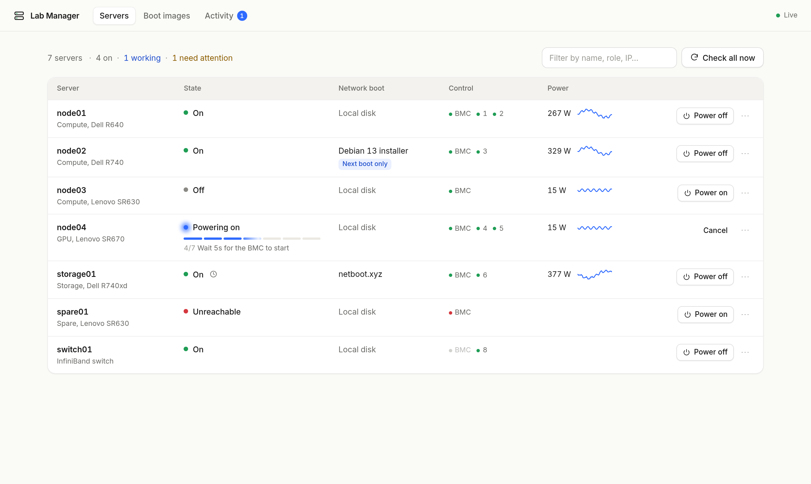
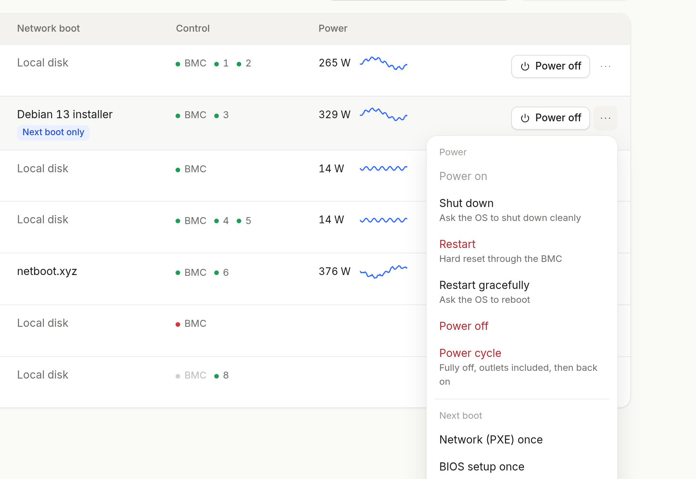
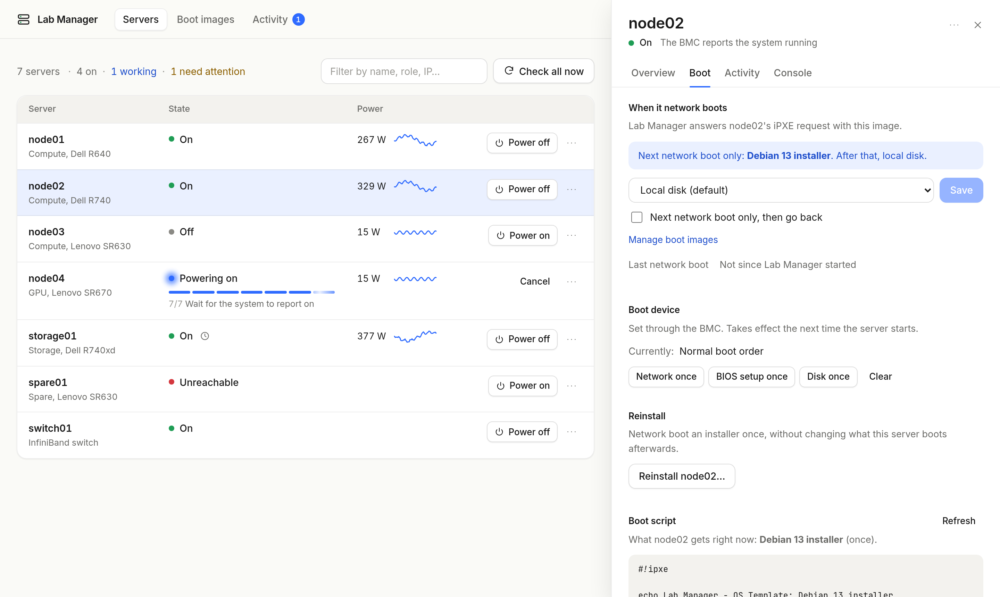
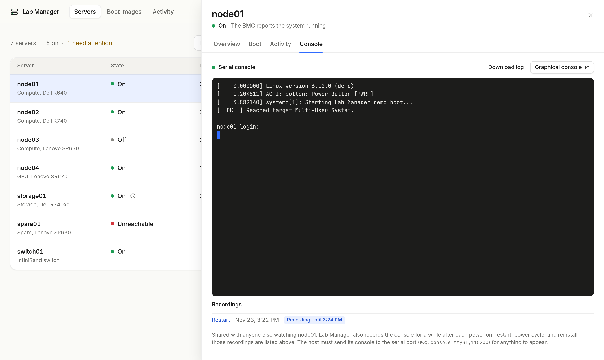
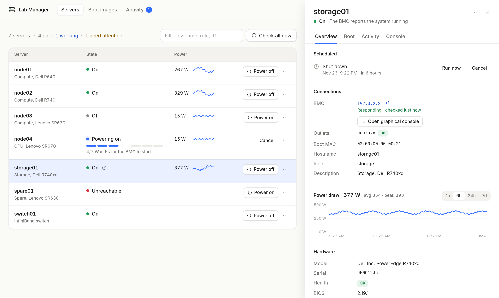
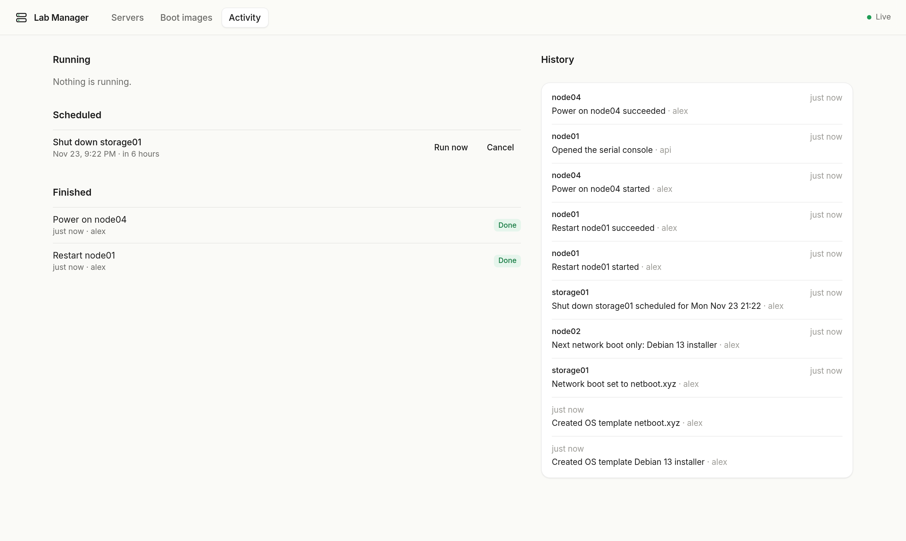

# User guide

This guide walks through the web UI. Every action here is also available through the
[API](api.md).

- [The servers list](#the-servers-list)
- [What each state means](#what-each-state-means)
- [Powering servers on and off](#powering-servers-on-and-off)
- [Scheduling](#scheduling)
- [Network boot](#network-boot)
- [Reinstalling a server](#reinstalling-a-server)
- [Consoles](#consoles)
- [Power draw and hardware](#power-draw-and-hardware)
- [Activity](#activity)
- [Troubleshooting](#troubleshooting)

## The servers list

Each row shows one server:

- **State**: what the server is doing now (see below). While an operation runs, a step
  track shows its progress, and the current step is spelled out under it. Hover over a state
  for the details behind it.
- **Network boot**: what Lab Manager will answer when this server network boots.
  **Next boot only** means it reverts after one boot.
- **Control**: the server's connections. **BMC** is its management controller, and each
  number is one of its PDU outlets. Green means reachable or on. Gray means off. Red means
  unreachable. Hover for the address and the last error.
- **Power**: current draw from the BMC, with the last hour as a sparkline.
- The main button does the obvious thing (power on or off, or **Cancel** while something is
  running). The **⋯** menu holds everything else.

Above the table, a summary counts servers that are on, working, or need attention
(unreachable, or powered with no BMC). Filter by name, description, BMC address, boot image, or any metadata (role, MAC, hostname).
**Check all now** polls every BMC and PDU immediately instead of waiting for the next
round.

Click a row to open the server panel on the right. It has four tabs: **Overview**, **Boot**,
**Activity**, and **Console**. The address bar follows along (`#/servers/node01/console`), so
you can bookmark or share a link to a specific tab.

The list updates live. There's no need to refresh, and changes made by other people or
scripts appear immediately. The dot at the top right shows the live connection.

## What each state means

| State | Meaning |
|---|---|
| **On** | The BMC reports the system running (or, without a BMC, its outlets are on). |
| **Off** | The system is off. Outlets may still be live, keeping the BMC up. If the outlets are off, the BMC is dark too, and the server still shows Off rather than Unreachable. |
| **Powered** | The outlets are on but the BMC isn't answering. It may be starting, or hung. A power cycle clears a hung BMC. |
| **Partly on** | A server with no BMC has some outlets on and some off. |
| **Unreachable** | Lab Manager can't reach the BMC (or the PDU). The panel shows why: no route, connection refused, login rejected. |
| **Checking** | Not polled yet; you'll see this right after startup. |
| **Powering on**, **Shutting down**, **Restarting**, … | An operation is running. |

## Powering servers on and off

| Action | What it does |
|---|---|
| **Power on** | Turns on any outlets that are off, waits for the BMC to answer, powers the system on, and waits until it reports on. |
| **Shut down** | Asks the OS to shut down cleanly (ACPI power button), and waits up to 5 minutes for the system to turn off. |
| **Restart** | A hard reset through the BMC, like the reset button. Without a BMC, it cycles the outlets. |
| **Restart gracefully** | Asks the OS to reboot itself. |
| **Power off** | Powers the system off through the BMC, then turns its outlets off. |
| **Power cycle** | Fully off (system, then outlets), pause, and back on. This is the fix for a hung BMC. |
| **Network (PXE) once**, **BIOS setup once** | Sets the boot device for the next start only. |
| **Turn on/off *outlet*** | Switches one PDU outlet directly. |
| **Send NMI** | A non-maskable interrupt. Linux usually panics and writes a crash dump if kdump is set up. |

Destructive actions ask for confirmation first.

Every action becomes an **operation**: a list of steps planned from the server's state
at that moment. Lab Manager runs one operation per server at a time, so a second request
for a busy server is refused instead of interleaved. Steps that talk to hardware are retried
with backoff. Steps that wait (for the BMC to come up, or for the system to report on) watch
the hardware, with a timeout, instead of sleeping a fixed time.

You can **cancel** an operation between steps. A failed operation shows which step failed
and the exact error in the server's Activity tab, and **Try again** re-plans from the
current state.

If Lab Manager stops while an operation is running, that operation is marked
**interrupted** at the next start and is not resumed. Re-run it yourself once you've looked
at the server.

> **Shut down does nothing?** The BMC sends an ACPI power-button press, and the OS decides
> what to do with it. Some images ignore it, such as systemd with `HandlePowerKey=ignore`
> or a host without `acpid`. Use **Power off** for those.

## Scheduling

**⋯ → Schedule…** runs a power on, power off, shutdown, or restart later. Scheduled
operations appear in the server's Overview and on the Activity page, each with **Run now**
and **Cancel**. They're planned when they run, from the state at that moment, and they
survive Lab Manager restarts.

## Network boot

When a server network boots, its iPXE asks Lab Manager what to boot, and Lab Manager finds
the server by its MAC address (`metadata.mac` in the config). The **Boot** tab controls the
answer:

- **When it network boots**: pick a boot image, or **Local disk**. Tick **Next network boot
  only, then go back** to serve it once. After one fetch, the server reverts to what it had
  before.
- **Boot device**: what the BMC will boot next time. Use **Network once** to make a server
  that normally boots from disk network boot.
- **Boot script**: the exact iPXE script this server gets right now, and when it last
  fetched one.

Boot images are managed on the **Boot images** page. An image is an iPXE chain URL (such
as `https://boot.netboot.xyz/menu.ipxe`), an inline iPXE script, or local disk. Scripts can
use the server's details: `{{.Hostname}}`, `{{.MAC}}`, `{{.Role}}`, and any metadata. To
set up the iPXE side, see [Network boot](network-boot.md).

## Reinstalling a server

**Boot → Reinstall…** (or **⋯ → Reinstall…**) does the whole sequence for you:

1. Serves the chosen installer on the server's next network boot only.
2. Tells the BMC to boot from the network once.
3. Hard resets the server, or powers it on if it's off.
4. Waits until the server fetches its boot script.

After that, the server boots from whatever it had before, so the freshly installed OS comes
up from disk. The serial console is recorded during the install (see below).

You'll be asked to type the server's name to confirm.

## Consoles

### Serial console

The **Console** tab connects to the server's serial port through its BMC. Lab Manager logs
in to the BMC over SSH with the configured credentials, and runs `console com2` on iDRAC or
`console 1` on XCC (configurable). Everyone watching a server shares one session, and
what's been printed recently is shown when you open it. **Download log** saves it.

For anything to appear, the host's OS must send its console to the serial port, e.g.
`console=ttyS1,115200` on the kernel command line for iDRAC, or `ttyS0` on many XCCs. A
serial getty gives you a login prompt.

### Recordings

After a power on, restart, power cycle, or reinstall, Lab Manager keeps the serial console
attached for 15 minutes and saves everything it prints. This works even if nobody has the
console open, so a boot that hung or an install that failed leaves a log. Recordings are
listed under the console and linked from the operation that started them. You can change
which operations record, and for how long, in the [configuration](configuration.md#console-recording).
Continuous recording is also available.

### Graphical console

**Open graphical console** (Overview tab, or **⋯ → Graphical console**) opens the server's
screen in a new tab, **without logging in to the BMC**:

- **Dell iDRAC9**: Lab Manager asks the iDRAC for a one-time console login and opens the
  iDRAC's own virtual console with it. This needs an iDRAC Enterprise or Datacenter license.
- **Lenovo XCC**: Lab Manager hosts the XCC's own viewer and logs it in with a one-time
  token. Lab Manager relays the console traffic, so your browser only talks to Lab Manager.
  The relay needs to reach the XCC on port 3900.
- **Other BMCs**: the BMC's web interface opens, and you log in there.

Your BMC password never reaches the browser. If the one-time login isn't available, the
BMC's web interface is still linked from the Overview tab.

## Power draw and hardware

Lab Manager reads each server's power draw from its BMC every 10 seconds and keeps a week
of it. The Overview tab charts it over 1 hour, 6 hours, 24 hours, or 7 days, with the
average and peak. Hover the chart for exact readings.

The Overview tab also shows:
- the server's connections (the BMC, which links to its web UI, outlets, MAC, and hostname)
- its hardware: model, serial, BIOS and BMC firmware, and health
- the BMC's recent event log, such as PSU faults, watchdog resets, and PCIe errors

## Activity

The **Activity** page shows what's running now, what's scheduled, recent operations, and the
full history of every change, with who made it. A server's own history is in its **Activity**
tab, where each operation expands to show its steps, attempts, and errors.

People are identified by their IP address, or by an `X-Labmgr-User` header if a proxy or
script sends one.

## Troubleshooting

**A server shows Unreachable.** Lab Manager can't reach the BMC over HTTPS. Hover the
state, or open the panel, for the reason. If it's a login error, check the credentials in
the config. If the server's outlets are off, it shows as Off instead, because a dark BMC is
expected then.

**Powered (amber) and it stays that way.** The outlets are live but the BMC isn't
answering. BMCs take a minute or two to boot after power is applied. If it doesn't come up,
**Power cycle** the server.

**The console connects but stays blank.** The BMC is attached to the serial port, but the
host isn't writing to it. Point the OS console at the BMC's serial port (see
[Serial console](#serial-console)). Some BMCs also need serial-over-LAN enabled in their
settings.

**The console won't attach, or drops right away.** Most BMCs allow only one serial
session at a time. Check whether someone is connected with `ipmitool sol` or through the
BMC's own web interface. Lab Manager shares its own session among all its viewers and
recordings, so it never competes with itself.

**The graphical console asks for a login.** The BMC couldn't issue a one-time login: the
iDRAC lacks the license, or it's a BMC Lab Manager doesn't know how to do this for. Log in
with the BMC's credentials.

**An operation failed.** Open the server's Activity tab. Each step shows its attempts and
the exact error. Fix the cause and press **Try again**.
